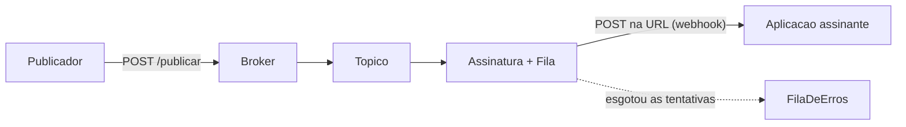

# Broker (S03_Broker): Arquitetura MOM e Padrões de Projeto

Intermediário de mensagens do projeto Pokémon. Recebe uma informação de uma aplicação, entrega a quem tem interesse e informa se deu certo ou errado. Não autentica, não aplica regra de negócio e não acessa o banco de ninguém: o conteúdo das mensagens é opaco para ele.

> Como instalar e executar: veja o [README.md](README.md).

## 1. Arquitetura: MOM

**MOM (Message-Oriented Middleware)** é um intermediário que permite a aplicações independentes se comunicarem por mensagens, de forma assíncrona e desacoplada.

**Modelo adotado: publish/subscribe.** Quem tem uma novidade publica em um tópico, e quem tem interesse assina. Cada assinatura tem a sua própria fila.

**Por que MOM neste projeto**

- São aplicações independentes, de equipes diferentes: sem intermediário, cada uma teria de conhecer todas as outras.
- O enunciado é feito de eventos: jogador cadastrado, então distribuir cartas.
- Se uma aplicação está fora do ar, a mensagem espera na fila e é reentregue.
- Uma falha não se espalha, e uma aplicação nova só precisa assinar o tópico.

**Elementos do MOM no código**

| Elemento do MOM | Classe | Papel |
|---|---|---|
| Produtor | `Publicador` | Cria a mensagem e entrega ao Broker |
| Broker | `Broker` | Valida, roteia, reentrega e informa o status |
| Canal (tópico) | `Topico` | Identificado pelo nome, gerencia suas assinaturas |
| Consumidor | `Assinante` | Recebe a mensagem e lança exceção se falhar |
| Inscrição | `Assinatura` | Liga tópico e assinante, conta as tentativas |
| Fila | `Fila` | Guarda as mensagens pendentes de cada assinatura |
| Dead letter queue | `FilaDeErros` | Guarda o que esgotou as tentativas, com o motivo |
| Transporte | API HTTP e `AssinanteWebhook` | Recebe publicações e entrega por POST |

**Fluxo de uma publicação**

1. A aplicação publica e recebe **202** com o id da mensagem.
2. O Broker valida o envelope e localiza o tópico.
3. Tenta entregar a cada assinante, por POST na URL cadastrada.
4. Se o assinante responde 2xx, concluído. Se não, a mensagem fica na fila da assinatura.
5. A reentrega repete a tentativa (3 por padrão) e, esgotadas, envia para a fila de erros.

**Garantias e limites**

- Entrega **"pelo menos uma vez"**: o receptor deve ignorar ids repetidos.
- O ACK significa **"aceito"**, não "processado".
- Desacopla identidade e tempo, mas não o **contrato** (nomes de tópicos e formato dos dados).
- Tudo em memória, sem garantia de ordem, chave de API única.

## 2. Padrões de projeto

| Padrão | Categoria | Onde está no código | Para quê | Situação |
|---|---|---|---|---|
| Observer | Comportamental | `Assinante`, `Topico` e `Broker.publicar` | Notificar vários assinantes sem acoplamento | Aplicado |
| Adapter | Estrutural | `AssinanteWebhook` | Adaptar uma chamada HTTP ao contrato `Assinante` | Aplicado |
| Facade | Estrutural | `Broker` | Esconder tópicos, filas, tentativas e fila de erros atrás de `publicar`, `assinar` e `listar` | Aplicado |
| Proxy (remoto) | Estrutural | `ClienteHttpBroker` | Usar o Broker pela rede com o mesmo contrato do local | Aplicado |
| Factory | Criacional | `Mensagem.criar` e a fábrica de assinantes da API | Centralizar a criação de objetos | Aplicado, em forma simples |

Duas observações:

- **Observer vs. pub/sub:** o Observer atua dentro de um processo, e o publish/subscribe é a sua versão distribuída, com um intermediário no meio.
- **Factory:** é uma fábrica simples, não o Factory Method clássico do GoF.

## 3. RabbitMQ × Broker do projeto

O RabbitMQ é um broker maduro, baseado em AMQP e usado em Python com a biblioteca `pika`. No exemplo da aula ele é o broker e o código é só cliente. No nosso projeto, o Broker é o produto desenvolvido.

**Mapeamento de conceitos**

| RabbitMQ | Broker do projeto |
|---|---|
| Exchange (roteamento por chave) | `Topico` (nome exato) |
| Queue | `Fila` (uma por assinatura) |
| Binding | `Assinatura` |
| Producer | `Publicador` |
| Consumer | `Assinante` |
| Dead letter exchange e queue | `FilaDeErros` |
| Ack do consumidor | Resposta HTTP 2xx |
| Nack e reenfileiramento | Falha, reentrega e nova tentativa |

**Principais diferenças**

| Aspecto | RabbitMQ | Broker do projeto |
|---|---|---|
| Protocolo | AMQP, binário | HTTP com JSON |
| Direção da conexão | O consumidor se conecta ao broker | O Broker chama o assinante (webhook) |
| Persistência | Mensagens e filas duráveis em disco | Tudo em memória |
| Confirmação | Ack explícito no protocolo | Resposta HTTP 2xx |
| Roteamento | Vários tipos de exchange, com curingas | Nome exato do tópico |
| Alta disponibilidade | Clusters e filas replicadas | Instância única |
| Segurança | Usuários, permissões e TLS | Chave de API única e opcional |
| O que a outra equipe precisa | Cliente AMQP (como o pika) | Qualquer coisa que fale HTTP |

**Por que construímos o nosso**

- O objetivo do projeto é construir o Broker e aplicar SOLID e padrões de projeto.
- HTTP é o denominador comum: a outra equipe só precisa de uma rota que aceite POST.
- Em um sistema real, a escolha seria o RabbitMQ, pela persistência e pela alta disponibilidade.
